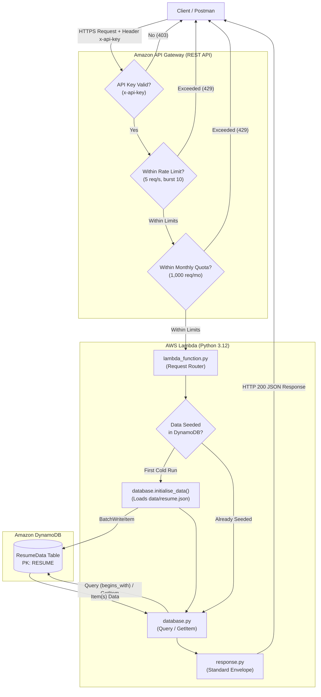

# Serverless Resume API – AWS Lambda, API Gateway & DynamoDB

A cloud-native, serverless REST API that securely serves professional resume information across multiple categorized HTTP endpoints using AWS Lambda, Amazon API Gateway, and Amazon DynamoDB. Designed and provisioned entirely via Infrastructure as Code (IaC) with AWS SAM and CloudFormation.

---

## Table of Contents

1. [Project Overview](#1-project-overview)
2. [Problem Statement](#2-problem-statement)
3. [Project Objectives](#3-project-objectives)
4. [Key Features](#4-key-features)
5. [Technology Stack](#5-technology-stack)
6. [System Architecture](#6-system-architecture)
7. [REST API Endpoints](#7-rest-api-endpoints)
8. [DynamoDB Database Design](#8-dynamodb-database-design)
9. [Project Directory Structure](#9-project-directory-structure)
10. [Prerequisites & Installation](#10-prerequisites--installation)
11. [Local Development & Testing](#11-local-development--testing)
12. [AWS Deployment Guide](#12-aws-deployment-guide)
13. [API Key Retrieval & Postman Testing](#13-api-key-retrieval--postman-testing)
14. [Security Considerations](#14-security-considerations)
15. [Cost Considerations & Free Tier Analysis](#15-cost-considerations--free-tier-analysis)
16. [Future Enhancements](#16-future-enhancements)
17. [License](#17-license)

---

## 1. Project Overview

The **Serverless Resume API** demonstrates how modern cloud-native architectures can replace traditional, monolithic server-based web hosting. Instead of running an always-on virtual machine (such as an EC2 instance) that incurs idle compute costs and requires manual OS patching, scaling, and load-balancer management, this application leverages AWS managed serverless services.

When a client sends an HTTP GET request with a valid API key, API Gateway validates the key, applies rate-limiting and monthly quotas, and triggers an AWS Lambda function running Python 3.12. The Lambda function queries an Amazon DynamoDB table using composite primary keys and returns structured, standardized JSON payloads.

---

## 2. Problem Statement

Traditional resume distribution methods (such as static PDF attachments or static personal websites) have several limitations:
- **No programmatic access:** Machine clients, automated portfolio integrations, and external recruitment platforms cannot consume resume data as structured JSON.
- **Server maintenance overhead:** Hosting simple REST APIs on server instances (e.g., EC2, VPS) requires continuous provisioning, security patching, monitoring, and fixed monthly operational costs even during zero-traffic periods.
- **Lack of access control and usage metering:** Standard static endpoints do not provide built-in throttling, burst control, or per-client quota tracking.

---

## 3. Project Objectives

- **Serverless Architecture:** Eliminate server management by utilizing AWS Lambda, Amazon API Gateway, and Amazon DynamoDB.
- **Granular Data Access:** Expose discrete endpoints for personal information, work experience, education, technical skills, and the full aggregated resume.
- **Infrastructure as Code (IaC):** Define 100% of the AWS infrastructure using AWS SAM (Serverless Application Model) and AWS CloudFormation for reproducible deployments.
- **Security-by-Design:** Enforce API Key authentication, strict rate throttling (5 req/sec, burst 10), and a monthly quota (1,000 requests) alongside least-privilege IAM policies.
- **Idempotent Data Seeding:** Implement an initialization pattern that seeds the DynamoDB table from a local `data/resume.json` baseline without redundant database writes.
- **Thorough Test Suite:** Maintain 100% offline unit test coverage using `pytest` without requiring an active AWS account.

---

## 4. Key Features

- **5 Dedicated REST Endpoints:** Retrieve isolated sections or the entire resume in clean JSON.
- **Single-Table DynamoDB Design:** Uses composite keys (`PK` and `SK`) and query operations (`begins_with`) to eliminate expensive full-table scans.
- **Standardized Response Envelope:** Consistent JSON response contract (`status`, `message`, `data`) across 200, 400, 404, 405, and 500 status codes.
- **API Key & Usage Plan Protection:** Restricts public abuse, applies token-bucket throttling, and tracks usage monthly.
- **Automated Cold-Start Data Seeding:** Automatically checks DynamoDB on first execution and seeds initial records via batch operations if empty.
- **Zero External Framework Dependencies:** Built purely on Python standard libraries and AWS SDK (`boto3`), keeping the deployment artifact tiny and cold starts fast.

---

## 5. Technology Stack

### Backend & Cloud
| Layer | Technology | Version / Specification |
|---|---|---|
| **Runtime** | Python | 3.12 |
| **Compute** | AWS Lambda | Serverless execution, 128 MB RAM, 30s timeout |
| **API Management** | Amazon API Gateway | REST API, Regional Endpoint |
| **Database** | Amazon DynamoDB | Single-table, On-Demand (PAY_PER_REQUEST), SSE enabled |
| **AWS SDK** | Boto3 / Botocore | 1.34.0 |
| **Security & Permissions** | AWS IAM | Least-privilege scoped execution role |
| **Infrastructure as Code** | AWS SAM / CloudFormation | Serverless Transform 2016-10-31 |

### Development & Tooling
- **Editor:** Visual Studio Code
- **Deployment Tools:** AWS CLI v2, AWS SAM CLI
- **Testing:** `pytest` (8.1.1), `pytest-mock` (3.14.0)
- **API Client:** Postman / cURL
- **Version Control:** Git & GitHub

---

## 6. System Architecture

The following diagram illustrates the complete request lifecycle:



---

## 7. REST API Endpoints

All endpoints require the `x-api-key` header and respond with a consistent JSON envelope:

```json
{
  "status": "success",
  "message": "<Description of the action>",
  "data": { ... }
}
```

### Endpoint Summary

| # | Endpoint | Method | Description | DynamoDB Operation |
|---|---|---|---|---|
| 1 | `/resume/personal` | `GET` | Contact details, title, links, and summary | `GetItem` (`SK=PERSONAL`) |
| 2 | `/resume/experience` | `GET` | Professional roles, responsibilities, achievements | `Query` (`SK begins_with "EXPERIENCE"`) |
| 3 | `/resume/education` | `GET` | Academic history, degree, GPA, coursework | `Query` (`SK begins_with "EDUCATION"`) |
| 4 | `/resume/skills` | `GET` | Categorized technical and professional skills | `GetItem` (`SK=SKILLS`) |
| 5 | `/resume` | `GET` | Complete aggregated resume containing all 4 sections | `Query` (`PK=RESUME`) |

### Example Response: `GET /resume/personal`
```json
{
  "status": "success",
  "message": "Personal information retrieved successfully.",
  "data": {
    "full_name": "Your Full Name",
    "title": "Cloud & Backend Engineer",
    "email": "your.email@example.com",
    "phone": "+91-XXXXX-XXXXX",
    "location": "City, State, India",
    "summary": "Motivated Computer Science student...",
    "linkedin": "https://www.linkedin.com/in/your-linkedin-username",
    "github": "https://github.com/your-github-username"
  }
}
```

### Error Response Schema
For client errors (400, 404, 405) and server errors (500), the response maintains the same structure:
```json
{
  "status": "error",
  "message": "Personal information not found.",
  "data": null
}
```

---

## 8. DynamoDB Database Design

The application implements a single-table architecture using a composite primary key to store heterogeneous entities:

- **Table Name:** `ResumeData` (configured via `DYNAMODB_TABLE_NAME` environment variable)
- **Partition Key (`PK`):** String (`S`) — Fixed value: `"RESUME"`
- **Sort Key (`SK`):** String (`S`) — Identifies the section or entity instance

### Table Record Layout

| Partition Key (`PK`) | Sort Key (`SK`) | Stored Attributes | Access Pattern |
|---|---|---|---|
| `RESUME` | `PERSONAL` | `full_name`, `title`, `email`, `phone`, `location`, `summary`, `linkedin`, `github` | `GetItem` (`PK=RESUME, SK=PERSONAL`) |
| `RESUME` | `EXPERIENCE_001` | `company`, `title`, `location`, `duration`, `responsibilities`, `achievements` | `Query` (`PK=RESUME, SK begins_with "EXPERIENCE"`) |
| `RESUME` | `EXPERIENCE_002` | `company`, `title`, `location`, `duration`, `responsibilities`, `achievements` | `Query` (`PK=RESUME, SK begins_with "EXPERIENCE"`) |
| `RESUME` | `EDUCATION_001` | `institution`, `degree`, `field_of_study`, `start_year`, `graduation_year`, `cgpa`, `relevant_coursework` | `Query` (`PK=RESUME, SK begins_with "EDUCATION"`) |
| `RESUME` | `SKILLS` | `programming_languages`, `cloud_technologies`, `databases`, `development_tools`, `other_skills` | `GetItem` (`PK=RESUME, SK=SKILLS`) |

### Optimization Highlights
- **Zero Full-Table Scans:** Every read operation uses `GetItem` or index-based `Query`, which consume minimal read capacity units (RCU).
- **Attribute Cleansing:** The database abstraction layer automatically strips internal partition (`PK`) and sort key (`SK`) fields before returning data to the client.

---

## 9. Project Directory Structure

```text
serverless-resume-api/
│
├── src/
│   ├── __init__.py              # Python package marker
│   ├── lambda_function.py       # API routing and HTTP request handlers
│   ├── database.py              # DynamoDB operations (GetItem, Query, BatchWrite)
│   └── response.py              # Standardized HTTP JSON response builder
│
├── data/
│   └── resume.json              # Initial seed data for the resume
│
├── tests/
│   ├── __init__.py              # Python package marker
│   ├── conftest.py              # Pytest setup with offline AWS mocks
│   ├── test_database.py         # 37 unit tests for the DynamoDB data layer
│   └── test_lambda.py           # 49 unit tests for routing and error scenarios
│
├── events/
│   └── api_event.json           # Sample API Gateway event payload for local invocation
│
├── template.yaml                # AWS SAM / CloudFormation Infrastructure as Code
├── requirements.txt             # Python project dependencies
├── samconfig.toml.example       # Example deployment configuration
├── .gitignore                   # Git exclusions (credentials, caches, builds)
├── .samignore                   # Exclusions for the deployed Lambda zip package
└── README.md                    # Comprehensive project documentation
```

---

## 10. Prerequisites & Installation

### Prerequisites
1. **Python 3.12** installed on your system.
2. **AWS CLI v2** installed and configured (`aws configure`).
3. **AWS SAM CLI** installed ([Install AWS SAM CLI](https://docs.aws.amazon.com/serverless-application-model/latest/developerguide/install-sam-cli.html)).
4. **Git** installed.

### Setup Instructions

1. **Clone the repository:**
   ```bash
   git clone https://github.com/<your-username>/serverless-resume-api.git
   cd serverless-resume-api
   ```

2. **Create and activate a virtual environment:**
   ```bash
   # Windows (PowerShell)
   python -m venv venv
   .\venv\Scripts\Activate.ps1

   # Linux / macOS
   python3 -m venv venv
   source venv/bin/activate
   ```

3. **Install dependencies:**
   ```bash
   pip install -r requirements.txt
   ```

4. **Customize Resume Data:**
   Open `data/resume.json` and replace the placeholder fields (e.g., name, contact details, college, experience) with your actual information.

---

## 11. Local Development & Testing

### Running the Pytest Suite
The test suite contains 86 comprehensive unit tests covering all 5 endpoints, missing records, invalid routes, database errors, and JSON response structure. All AWS interactions are mocked, so no AWS connection or credentials are needed.

Execute the test suite from the project root:
```bash
python -m pytest tests -v
```

Expected output:
```text
============================= test session starts =============================
platform win32 -- Python 3.14.x, pytest-8.1.1, pluggy-1.7.0
collected 86 items

serverless-resume-api/tests/test_database.py .................................... [ 41%]
serverless-resume-api/tests/test_lambda.py ...................................... [100%]

============================= 86 passed in 0.38s ==============================
```

### Local Function Invocation with SAM CLI
You can test the Lambda handler locally using the sample event payload:
```bash
sam local invoke ResumeApiFunction -e events/api_event.json
```

---

## 12. AWS Deployment Guide

Deploying the application creates the DynamoDB table, IAM roles, Lambda function, API Gateway REST API, and associated API key/usage plan.

### Step 1: Validate the SAM Template
```bash
sam validate
```

### Step 2: Build the Application
```bash
sam build
```

### Step 3: Deploy to AWS
Run the guided deployment command for your initial deployment:
```bash
sam deploy --guided
```

You will be prompted for configuration values. Use the following recommended inputs:
- **Stack Name:** `serverless-resume-api`
- **AWS Region:** `us-east-1` (or your preferred region)
- **Parameter StageName:** `prod`
- **Confirm changes before deploy:** `Y`
- **Allow SAM CLI IAM role creation:** `Y`
- **Disable rollback for deployments:** `N`
- **Save arguments to configuration file:** `Y`
- **SAM configuration file:** `samconfig.toml`
- **SAM configuration environment:** `default`

Subsequent deployments can be run with just:
```bash
sam deploy
```

### CloudFormation Outputs
Upon completion, the deployment outputs will display:
- `ApiBaseUrl`: Base URL of your deployed API Gateway stage.
- `LambdaFunctionName`: The function name for log monitoring.
- `DynamoDBTableName`: `ResumeData`.
- `RetrieveApiKeyCommand`: Ready-to-run AWS CLI command to view your API key.

---

## 13. API Key Retrieval & Postman Testing

### Retrieving Your API Key
API keys generated by SAM Usage Plans are securely created in API Gateway. Run the following command (substituting your AWS region if different):

```bash
aws apigateway get-api-keys --include-values --query "items[*].{Name:name,Value:value}" --output table --region us-east-1
```

Copy the value displayed under the `Value` column.

### Testing Endpoints with Postman

1. Open **Postman** and create a new request.
2. Set the HTTP method to **`GET`**.
3. Enter the endpoint URL (replace `<api-id>` and `<region>` with your values):
   ```text
   https://<api-id>.execute-api.<region>.amazonaws.com/prod/resume
   ```
4. Navigate to the **Headers** tab and add:
   - **Key:** `x-api-key`
   - **Value:** `<YOUR_COPIED_API_KEY>`
5. Click **Send**.
6. Verify the `200 OK` response.

### Testing with cURL
```bash
curl -X GET "https://<api-id>.execute-api.<region>.amazonaws.com/prod/resume/personal" \
     -H "x-api-key: YOUR_API_KEY_HERE"
```

### Testing Throttling & Security
- **Missing API Key:** Remove the `x-api-key` header and send a request. API Gateway will return `403 Forbidden` (`{"message": "Forbidden"}`).
- **Rate Limit Test:** Send more than 10 requests rapidly in Postman (or via a loop script). API Gateway will return `429 Too Many Requests`.

---

## 14. Security Considerations

1. **API Key Authentication:**
   - Every route in the API requires the `x-api-key` header.
   - *Architectural Note:* In API Gateway, API keys are intended for **client identification, rate limiting, and quota tracking**, not for user identity/authentication. For end-user identity verification, Amazon Cognito User Pools or OAuth 2.0 / JWT Lambda Authorizers should be used.
2. **Least-Privilege IAM Execution Role:**
   - The Lambda function execution role grants access only to the specific DynamoDB table ARN.
   - Actions are strictly limited to `dynamodb:GetItem`, `dynamodb:Query`, `dynamodb:PutItem`, and `dynamodb:BatchWriteItem`.
   - General table listing, schema modification, and wildcard permissions (`Resource: "*"`) are prohibited.
3. **Encryption at Rest & in Transit:**
   - **In Transit:** All API Gateway communication is strictly enforced over HTTPS (TLS 1.2+).
   - **At Rest:** DynamoDB table encryption is enabled with AWS-managed encryption keys (`SSEEnabled: true`).
4. **Data Sanitization & Error Handling:**
   - Internal exception messages and stack traces are logged to Amazon CloudWatch and **never** returned in HTTP responses.
   - Database internal keys (`PK`, `SK`) are stripped from payloads prior to serializing responses.
5. **Credential Protection:**
   - AWS access keys and API keys are excluded from git version control via `.gitignore`.
   - The deployment template avoids hardcoded credentials.

---

## 15. Cost Considerations & Free Tier Analysis

This architecture was specifically engineered to operate well within the **AWS Free Tier**:

| Service | Free Tier Allocation | Estimated Resume API Usage | Projected Cost |
|---|---|---|---|
| **AWS Lambda** | 1,000,000 requests/month & 3.2M sec compute | < 2,000 requests/month (128 MB RAM) | **$0.00** |
| **Amazon API Gateway** | 1,000,000 REST API calls/month (12 months free) | < 2,000 requests/month | **$0.00** |
| **Amazon DynamoDB** | 25 GB storage, 25 WCU, 25 RCU (Always Free) | < 1 MB storage, On-demand requests | **$0.00** |
| **Amazon CloudWatch** | 5 GB log ingestion (Always Free) | < 50 MB log data | **$0.00** |

Even beyond the Free Tier, on-demand pricing for this workload amounts to fractions of a cent per month ($0.000003 per Lambda invocation).

---

## 16. Future Enhancements

- **PDF Generation Endpoint:** Add a `/resume/download` endpoint that renders an HTML template to PDF via a Lambda Layer.
- **Cognito Integration:** Upgrade from API key identification to OAuth2 / JWT authentication using Amazon Cognito for personalized views.
- **CloudFront Global Caching:** Attach an Amazon CloudFront distribution in front of API Gateway for sub-millisecond edge caching of resume data.
- **CI/CD Automation:** Implement GitHub Actions to run pytest and auto-deploy updates to AWS on merge to `main`.

---

## 17. License

This project is licensed under the MIT License. See the [LICENSE](LICENSE) file for details.
